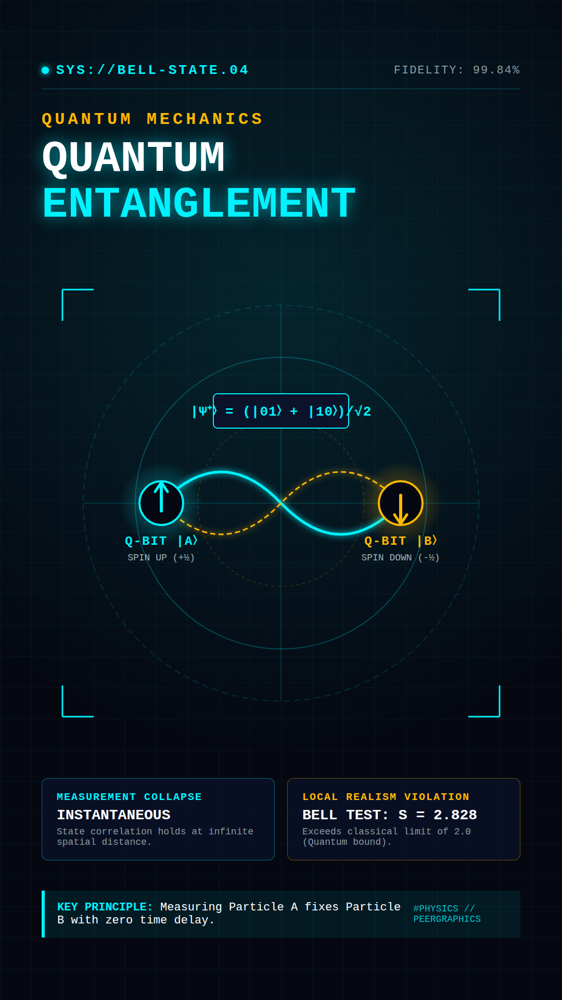
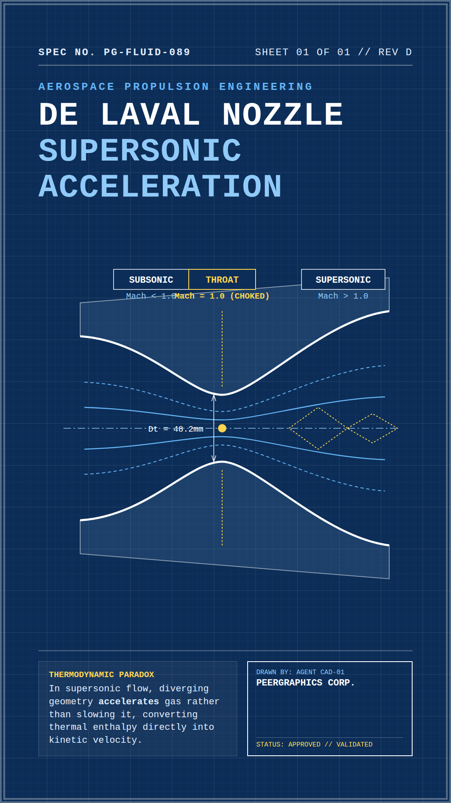
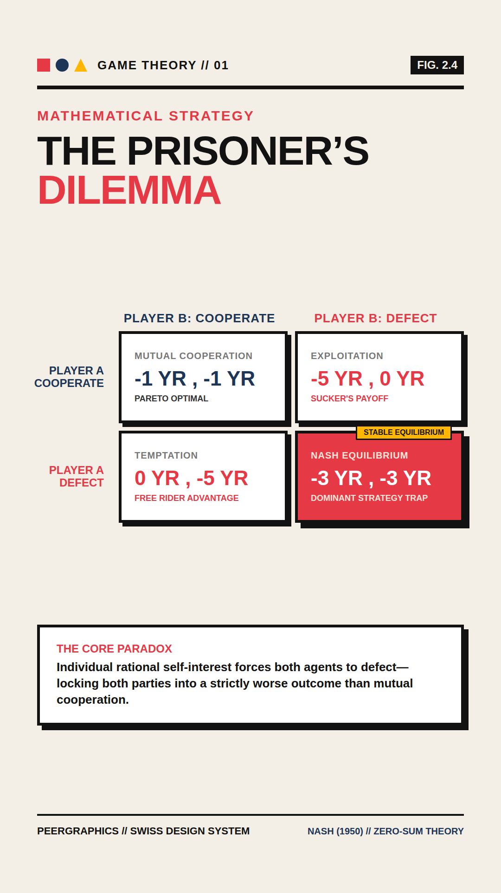
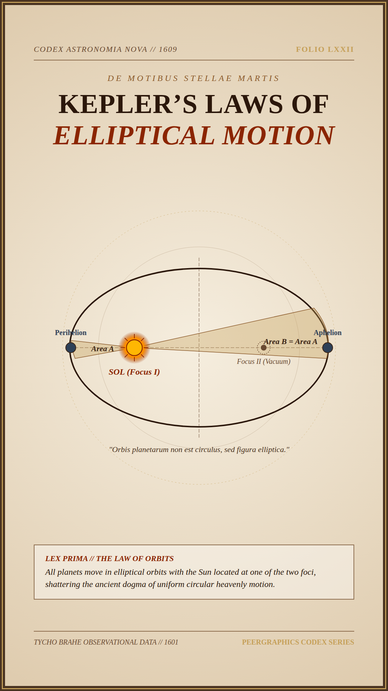
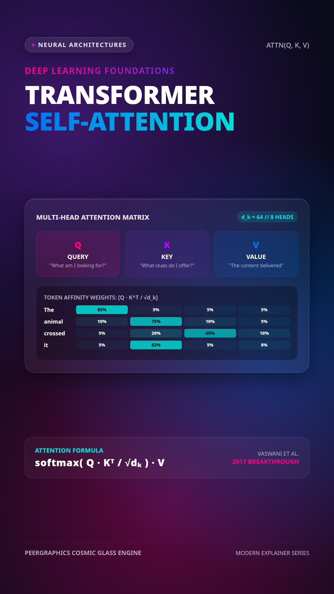
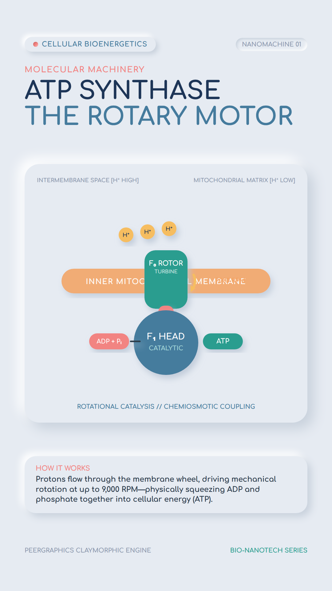
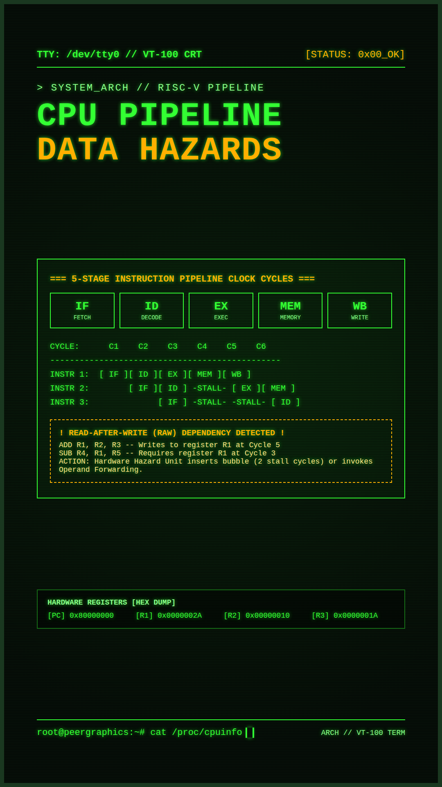
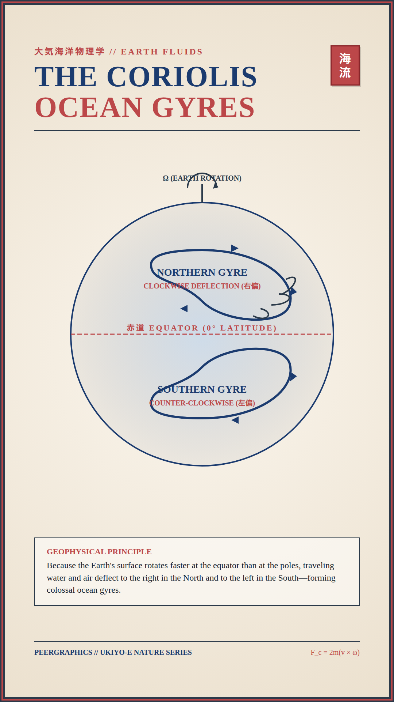
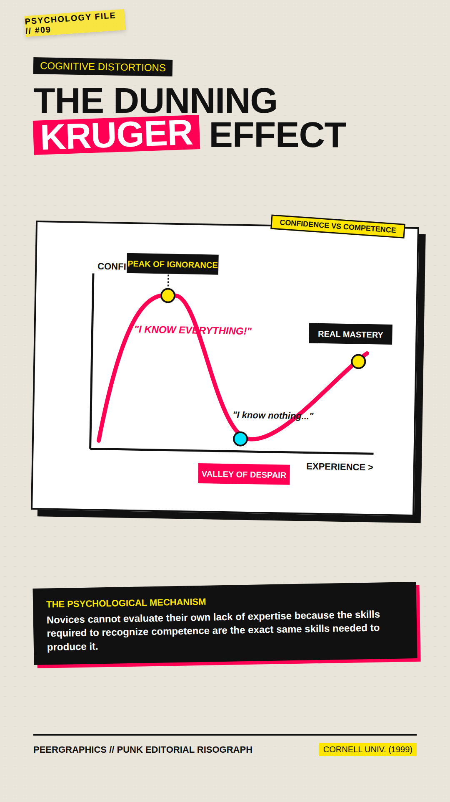
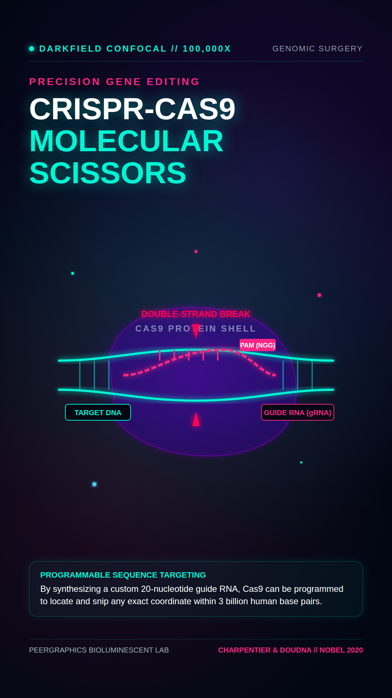

# 🎭 PeerThemes

> **10 Production-Ready React, SVG & CSS Design Systems for Educational Video Motion Graphics — Powered by [Remotion](https://www.remotion.dev/)**

`PeerThemes` is a curated collection of **10 completely distinct visual design systems** engineered for vertical educational video production (9:16 aspect ratio, 1080 × 1920, 30 fps) on YouTube Shorts, TikTok, and Instagram Reels.

Every theme is built entirely with **pure React, SVG, and CSS**, ensuring deterministic, frame-accurate rendering with zero external image dependencies.

---

## 🎨 Theme Gallery

| 01. Cyber HUD | 02. Vintage Blueprint | 03. Swiss Bauhaus |
|:---:|:---:|:---:|
|  |  |  |
| **Quantum & AI** | **Aerospace & Mechanics** | **Game Theory & Math** |

| 04. Renaissance Codex | 05. Cosmic Glass | 06. Isometric Clay |
|:---:|:---:|:---:|
|  |  |  |
| **Astronomy & History** | **Deep Learning & SaaS** | **Cellular Biology** |

| 07. Phosphor Terminal | 08. Japanese Ukiyo-e | 09. Punk Editorial | 10. Bioluminescent |
|:---:|:---:|:---:|:---:|
|  |  |  |  |
| **Computer Architecture** | **Earth & Oceanography** | **Cognitive Psychology** | **Genetics & CRISPR** |

---

## 🔬 Detailed Theme Specifications

### 01. Cyber HUD & Holographic Sci-Fi
- **Component**: [`src/themes/Theme1_CyberHUD.tsx`](src/themes/Theme1_CyberHUD.tsx)
- **Concept Shown**: *Quantum Entanglement & Bell State Polarization*
- **Color Palette**:
  - Background: Space Void `#050811`
  - Neon Cyan Accent: `#00F2FE`
  - Amber Pulse: `#FFB800`
  - Deep Navy Card: `#0B132B`
- **Typography & Geometry**: Monospace (`Courier New`), circular radar rings, target brackets, quantum state formulas, micro-telemetry readouts.
- **Recommended Subjects**: Quantum computing, artificial intelligence, networking protocols, particle physics, edge computing.

---

### 02. Vintage Technical Blueprint
- **Component**: [`src/themes/Theme2_VintageBlueprint.tsx`](src/themes/Theme2_VintageBlueprint.tsx)
- **Concept Shown**: *De Laval Nozzle // Supersonic Gas Acceleration*
- **Color Palette**:
  - Prussian Blue: `#0C2D57`
  - Drafting Chalk White: `#FFFFFF`
  - Cyan Guide Lines: `#64B5F6`
  - Dimension Gold: `#FFD54F`
- **Typography & Geometry**: Engineering drafting grid (100px & 20px), dimension tolerances ($\pm 0.05\text{mm}$), Mach numbers, exhaust expansion diamonds, CAD title block.
- **Recommended Subjects**: Aerospace engineering, fluid mechanics, rocket propulsion, mechanical systems, thermodynamics.

---

### 03. Swiss Bauhaus & Neo-Brutalist
- **Component**: [`src/themes/Theme3_SwissBauhaus.tsx`](src/themes/Theme3_SwissBauhaus.tsx)
- **Concept Shown**: *The Prisoner's Dilemma & Nash Equilibrium*
- **Color Palette**:
  - Stark Canvas: `#F3EFE6`
  - Heavy Ink: `#121212`
  - Vermilion Red: `#E63946`
  - Deep Cobalt: `#1D3557`
  - Cadmium Yellow: `#FFB703`
- **Typography & Geometry**: Bold grotesque typography (Helvetica / Inter 900), heavy 6px black borders, 2×2 payoff matrix cards with hard drop shadows, clean geometric shapes.
- **Recommended Subjects**: Game theory, behavioral economics, probability, logic puzzles, statistical paradoxes.

---

### 04. Renaissance Codex & Da Vinci Manuscript
- **Component**: [`src/themes/Theme4_RenaissanceCodex.tsx`](src/themes/Theme4_RenaissanceCodex.tsx)
- **Concept Shown**: *Kepler's First Law of Planetary Motion*
- **Color Palette**:
  - Aged Vellum Parchment: `#EFE2C9`
  - Hand-Inked Sepia: `#2B170B`
  - Gilded Gold Leaf: `#C5A059`
  - Cinnabar Earth: `#8B2500`
- **Typography & Geometry**: Serif calligraphy (Georgia / Garamond), compass construction arcs, elliptical orbits with two foci, equal area sweep sectors, Latin marginalia.
- **Recommended Subjects**: History of science, classical celestial mechanics, optics, ancient discoveries, philosophy.

---

### 05. Cosmic Glassmorphism & Aurora
- **Component**: [`src/themes/Theme5_CosmicGlass.tsx`](src/themes/Theme5_CosmicGlass.tsx)
- **Concept Shown**: *Transformer Multi-Head Self-Attention*
- **Color Palette**:
  - Midnight Obsidian: `#090A1A`
  - Electric Purple Glow: `#7928CA`
  - Azure Cyan: `#0070F3`
  - Hot Magenta: `#FF0080`
  - Bright Turquoise: `#00DFD8`
- **Typography & Geometry**: Modern sans-serif, translucent frosted glass cards with `backdrop-filter: blur`, iridescent 1px borders, token affinity heatmaps, soft gradient pills.
- **Recommended Subjects**: Neural networks, transformer architectures, modern software engineering, cloud computing, generative AI.

---

### 06. Tactile Isometric Claymorphism
- **Component**: [`src/themes/Theme6_IsometricClay.tsx`](src/themes/Theme6_IsometricClay.tsx)
- **Concept Shown**: *ATP Synthase // Cellular Molecular Motor*
- **Color Palette**:
  - Soft Slate Background: `#E6EBF2`
  - Pastel Coral: `#F28482`
  - Mint Green: `#2A9D8F`
  - Soft Butter Yellow: `#F6BD60`
  - Deep Blueberry: `#1D3557`
- **Typography & Geometry**: Rounded pillowy typography (Nunito), pneumatic clay shadows (`feDropShadow`), rounded tactile capsules, molecular rotor cutaway.
- **Recommended Subjects**: Cellular biology, biochemistry, intuitive mechanical models, beginner-friendly science.

---

### 07. Phosphor CRT Terminal (VT-100)
- **Component**: [`src/themes/Theme7_PhosphorTerminal.tsx`](src/themes/Theme7_PhosphorTerminal.tsx)
- **Concept Shown**: *CPU Pipeline Hazards & RAW Dependencies*
- **Color Palette**:
  - CRT Black: `#071009`
  - Phosphor Green Bloom: `#33FF33`
  - Terminal Amber: `#FFB000`
  - CRT Screen Frame: `#1A3820`
- **Typography & Geometry**: Monospace terminal font, CRT scanline overlay, ASCII architecture tables, clock-cycle diagrams, hardware hex register dumps, blinking block cursor.
- **Recommended Subjects**: Computer architecture, low-level systems (C/Rust/Assembly), compilers, cybersecurity, operating systems.

---

### 08. Japanese Ukiyo-e Woodblock Infographic
- **Component**: [`src/themes/Theme8_JapaneseUkiyoE.tsx`](src/themes/Theme8_JapaneseUkiyoE.tsx)
- **Concept Shown**: *The Coriolis Effect & Ocean Gyres*
- **Color Palette**:
  - Textured Washi Cream: `#F7EFE1`
  - Ocean Prussian Blue: `#1B3B6F`
  - Deep Indigo: `#2B3A4A`
  - Vermilion Red: `#BC4749`
- **Typography & Geometry**: Mincho serif typography, Hokusai wave crest curves, traditional red Hanko signature seals, planetary vortex deflection vectors.
- **Recommended Subjects**: Oceanography, meteorology, earth climate systems, fluid dynamics, ecology, geology.

---

### 09. Punk Editorial & Risograph Collage
- **Component**: [`src/themes/Theme9_EditorialCollage.tsx`](src/themes/Theme9_EditorialCollage.tsx)
- **Concept Shown**: *The Dunning-Kruger Effect & Cognitive Bias*
- **Color Palette**:
  - Newsprint Halftone: `#EAE5DB`
  - High-Voltage Yellow: `#FFE600`
  - Risograph Pink: `#FF0055`
  - Heavy Charcoal: `#111111`
  - Cyan Accent: `#00E5FF`
- **Typography & Geometry**: Slanted impact cutout typography, duct tape strips, neon yellow highlighter marker scribbles, graph paper curve with peak and valley callouts.
- **Recommended Subjects**: Cognitive psychology, behavioral economics, sociology, media literacy, human decision biases.

---

### 10. Bioluminescent Microscopic Darkfield
- **Component**: [`src/themes/Theme10_BioluminescentDarkfield.tsx`](src/themes/Theme10_BioluminescentDarkfield.tsx)
- **Concept Shown**: *CRISPR-Cas9 Molecular Scissors*
- **Color Palette**:
  - Oceanic Abyss: `#020713`
  - Bioluminescent Turquoise: `#00F5D4`
  - Electric Magenta: `#F72585`
  - Deep Violet Halo: `#7209B7`
- **Typography & Geometry**: High-contrast modern sans, caustic refractive light halos, translucent Cas9 protein volumetric cloud, glowing unwound DNA-gRNA duplex.
- **Recommended Subjects**: Genetics, molecular biology, CRISPR biotech, neuroscience, photonics, deep-sea biology.

---

## 🚀 Quickstart

### 1. Installation
Clone the repository and install dependencies:

```bash
git clone https://github.com/phyroosh/PeerThemes.git
cd PeerThemes
npm install
```

### 2. Interactive Remotion Studio Preview
Launch the browser studio to interactively preview all 10 themes:

```bash
npm run dev
```

### 3. Render High-Resolution Still Frames
Render a still frame for any theme in **under 350ms**:

```bash
# Render Theme 1 (Cyber HUD)
npm run still:01

# Render Theme 5 (Cosmic Glass)
npm run still:05

# Or use remotion CLI directly:
npx remotion still src/index.ts Theme-03-SwissBauhaus out/swiss_still.png
```

---

## 🤖 Using with AI Video-Generating Agents

These themes are designed to serve as plug-and-play visual engines for autonomous video-generation agents (such as `PeerGraphics`). Agents can easily:

1. Import any theme component from `src/themes/`.
2. Swap out titles, subtitles, formulas, and SVG diagram nodes dynamically using React props.
3. Attach voiceover narration audio tracks to render completed, ready-to-upload educational YouTube Shorts and Reels.

---

## 📄 License
MIT © [phyroosh](https://github.com/phyroosh)
