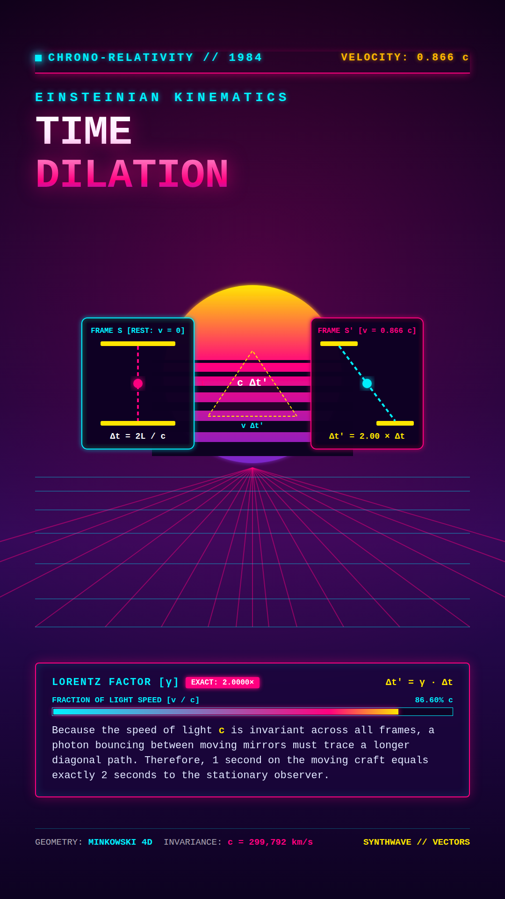
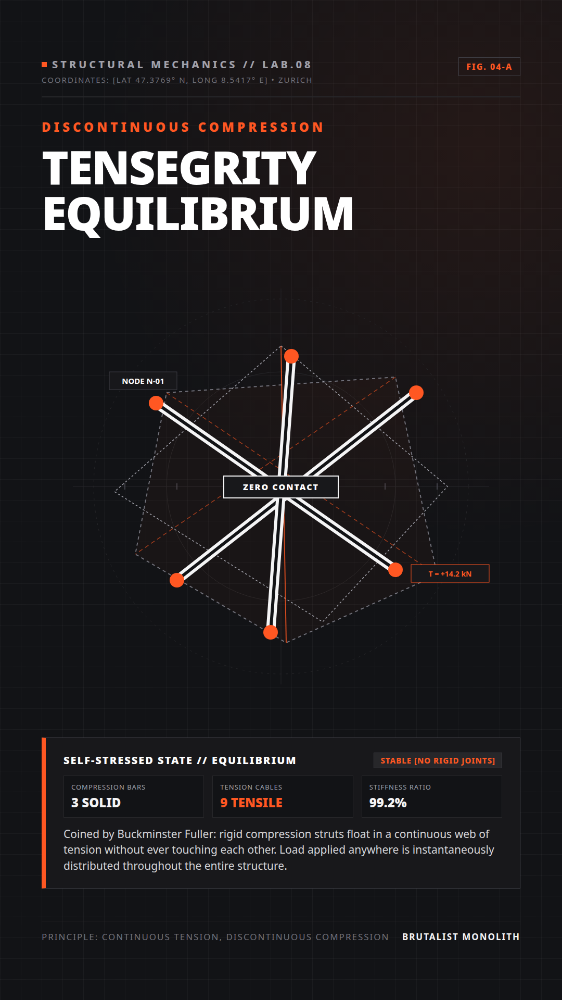
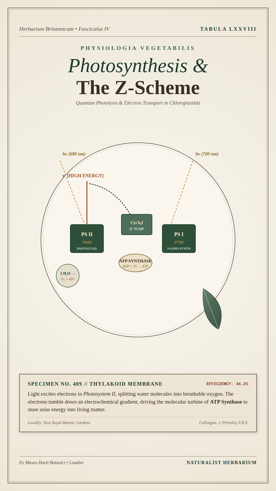
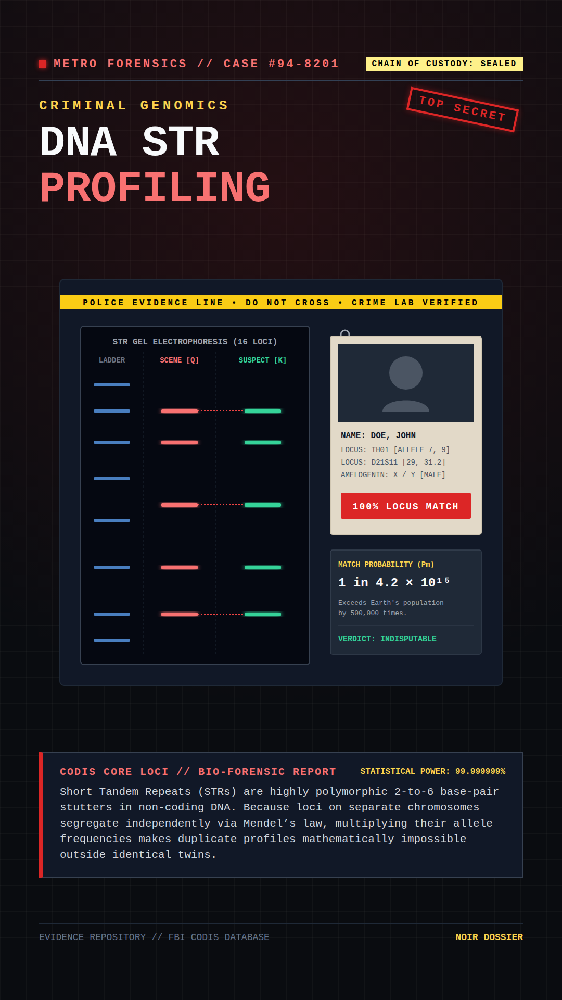
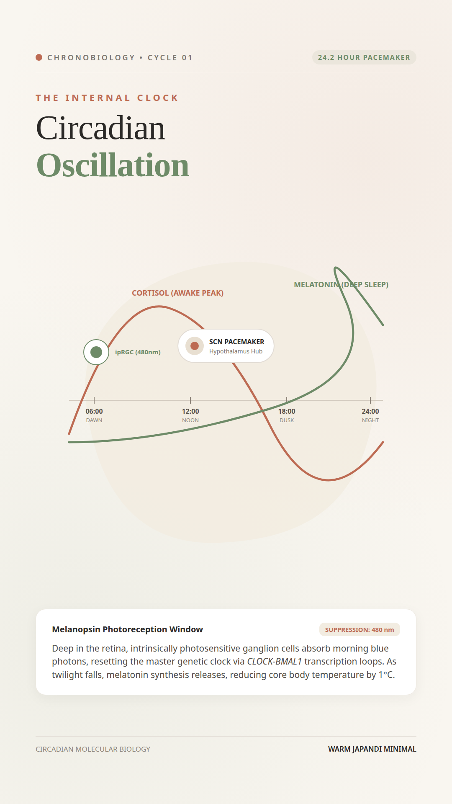
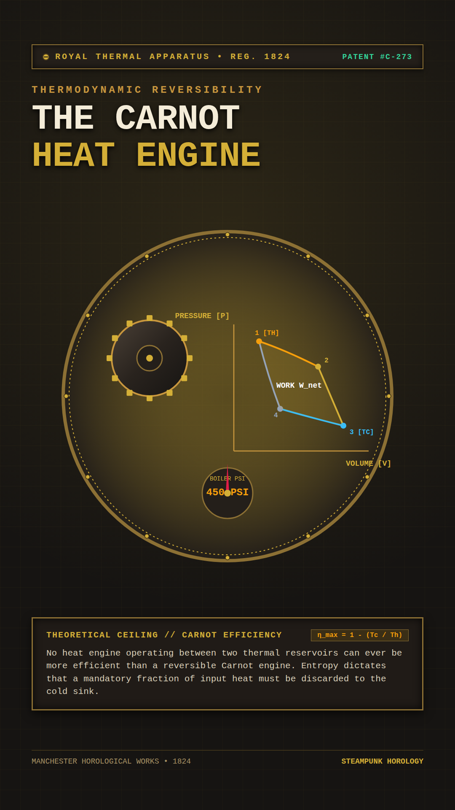
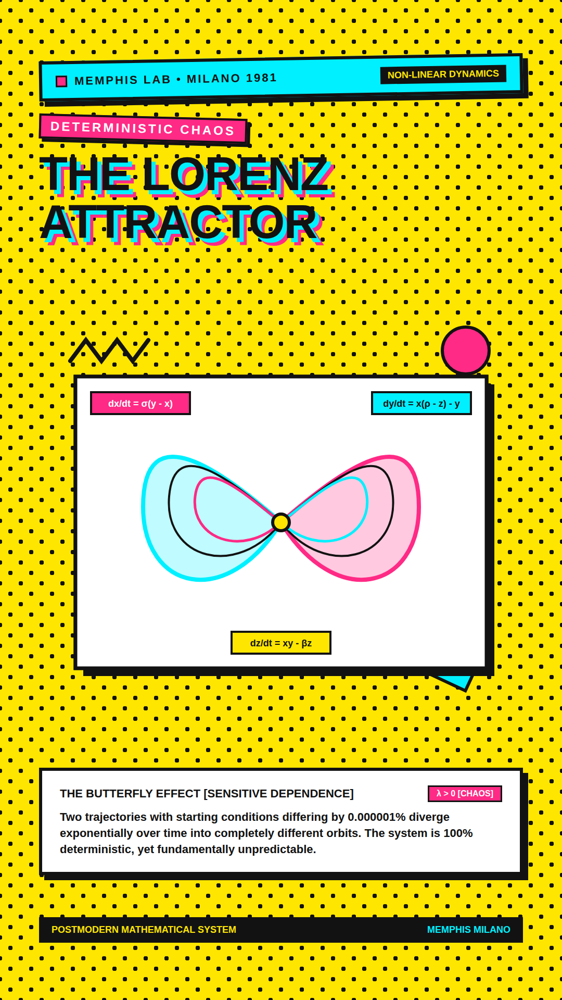
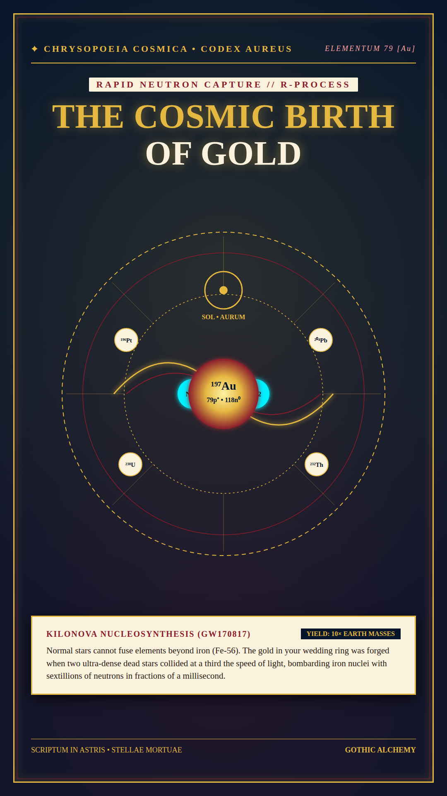
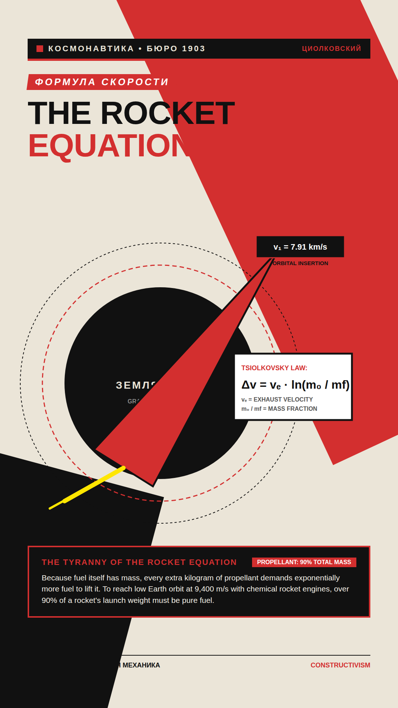
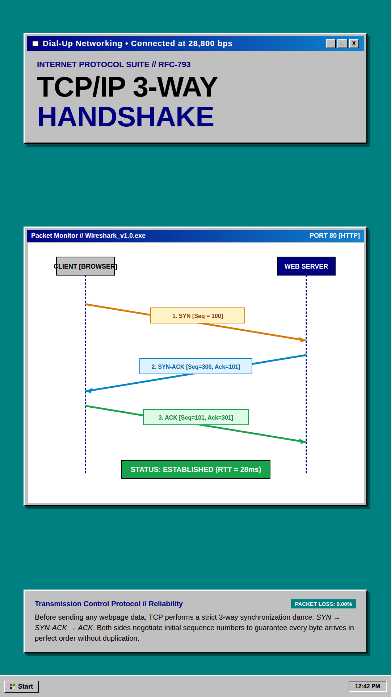

# 🎭 PeerThemes

> **20 Production-Ready React, SVG & CSS Design Systems for Educational Video Motion Graphics — Powered by [Remotion](https://www.remotion.dev/)**

`PeerThemes` is a curated collection of **20 completely distinct visual design systems** engineered for vertical educational video production (9:16 aspect ratio, 1080 × 1920, 30 fps) on YouTube Shorts, TikTok, and Instagram Reels.

Every theme is built entirely with **pure React, SVG, and CSS**, ensuring deterministic, frame-accurate rendering with zero external image dependencies.

---

## 🎨 Theme Gallery

### Batch 1: Themes 01 – 10

| 01. Cyber HUD | 02. Vintage Blueprint | 03. Swiss Bauhaus |
|:---:|:---:|:---:|
|  |  |  |
| **Quantum & AI** | **Aerospace & Mechanics** | **Game Theory & Math** |

| 04. Renaissance Codex | 05. Cosmic Glass | 06. Isometric Clay |
|:---:|:---:|:---:|
|  |  |  |
| **Astronomy & History** | **Deep Learning & SaaS** | **Cellular Biology** |

| 07. Phosphor Terminal | 08. Japanese Ukiyo-e | 09. Punk Editorial | 10. Bioluminescent |
|:---:|:---:|:---:|:---:|
|  |  |  |  |
| **Computer Architecture** | **Earth & Oceanography** | **Cognitive Psychology** | **Genetics & CRISPR** |

---

### Batch 2: Themes 11 – 20

| 11. Synthwave Outrun | 12. Charcoal Brutalism | 13. Botanical Herbarium |
|:---:|:---:|:---:|
|  |  |  |
| **Relativity & Kinematics** | **Tensegrity Structures** | **Photosynthesis Z-Scheme** |

| 14. Noir Dossier | 15. Warm Japandi | 16. Steampunk Horology |
|:---:|:---:|:---:|
|  |  |  |
| **Forensic DNA Profiling** | **Circadian Biology** | **Carnot Thermodynamics** |

| 17. Memphis Milano Pop | 18. Gothic Golden Alchemy | 19. Soviet Constructivism | 20. Retro Windows 95 |
|:---:|:---:|:---:|:---:|
|  |  |  |  |
| **Lorenz Chaos Attractor** | **Stellar Nucleosynthesis** | **Rocket Equation (Tsiolkovsky)** | **TCP/IP 3-Way Handshake** |

---

## 🔬 Detailed Theme Specifications

### 01. Cyber HUD & Holographic Sci-Fi
- **Component**: [`src/themes/Theme1_CyberHUD.tsx`](src/themes/Theme1_CyberHUD.tsx)
- **Concept Shown**: *Quantum Entanglement & Bell State Polarization*
- **Color Palette**: Space Void `#050811`, Neon Cyan `#00F2FE`, Amber Pulse `#FFB800`, Deep Navy `#0B132B`.
- **Typography & Geometry**: Monospace (`Courier New`), circular radar rings, target brackets, quantum state formulas, micro-telemetry readouts.
- **Recommended Subjects**: Quantum computing, artificial intelligence, networking protocols, particle physics, edge computing.

---

### 02. Vintage Technical Blueprint
- **Component**: [`src/themes/Theme2_VintageBlueprint.tsx`](src/themes/Theme2_VintageBlueprint.tsx)
- **Concept Shown**: *De Laval Nozzle // Supersonic Gas Acceleration*
- **Color Palette**: Prussian Blue `#0C2D57`, Drafting Chalk White `#FFFFFF`, Cyan Guide Lines `#64B5F6`, Dimension Gold `#FFD54F`.
- **Typography & Geometry**: Engineering drafting grid (100px & 20px), dimension tolerances ($\pm 0.05\text{mm}$), Mach numbers, exhaust expansion diamonds, CAD title block.
- **Recommended Subjects**: Aerospace engineering, fluid mechanics, rocket propulsion, mechanical systems, thermodynamics.

---

### 03. Swiss Bauhaus & Neo-Brutalist
- **Component**: [`src/themes/Theme3_SwissBauhaus.tsx`](src/themes/Theme3_SwissBauhaus.tsx)
- **Concept Shown**: *The Prisoner's Dilemma & Nash Equilibrium*
- **Color Palette**: Stark Canvas `#F3EFE6`, Heavy Ink `#121212`, Vermilion Red `#E63946`, Deep Cobalt `#1D3557`, Cadmium Yellow `#FFB703`.
- **Typography & Geometry**: Bold grotesque typography (Helvetica / Inter 900), heavy 6px black borders, 2×2 payoff matrix cards with hard drop shadows, clean geometric shapes.
- **Recommended Subjects**: Game theory, behavioral economics, probability, logic puzzles, statistical paradoxes.

---

### 04. Renaissance Codex & Da Vinci Manuscript
- **Component**: [`src/themes/Theme4_RenaissanceCodex.tsx`](src/themes/Theme4_RenaissanceCodex.tsx)
- **Concept Shown**: *Kepler's First Law of Planetary Motion*
- **Color Palette**: Aged Vellum Parchment `#EFE2C9`, Hand-Inked Sepia `#2B170B`, Gilded Gold Leaf `#C5A059`, Cinnabar Earth `#8B2500`.
- **Typography & Geometry**: Serif calligraphy (Georgia / Garamond), compass construction arcs, elliptical orbits with two foci, equal area sweep sectors, Latin marginalia.
- **Recommended Subjects**: History of science, classical celestial mechanics, optics, ancient discoveries, philosophy.

---

### 05. Cosmic Glassmorphism & Aurora
- **Component**: [`src/themes/Theme5_CosmicGlass.tsx`](src/themes/Theme5_CosmicGlass.tsx)
- **Concept Shown**: *Transformer Multi-Head Self-Attention*
- **Color Palette**: Midnight Obsidian `#090A1A`, Electric Purple Glow `#7928CA`, Azure Cyan `#0070F3`, Hot Magenta `#FF0080`, Bright Turquoise `#00DFD8`.
- **Typography & Geometry**: Modern sans-serif, translucent frosted glass cards with `backdrop-filter: blur`, iridescent 1px borders, token affinity heatmaps, soft gradient pills.
- **Recommended Subjects**: Neural networks, transformer architectures, modern software engineering, cloud computing, generative AI.

---

### 06. Tactile Isometric Claymorphism
- **Component**: [`src/themes/Theme6_IsometricClay.tsx`](src/themes/Theme6_IsometricClay.tsx)
- **Concept Shown**: *ATP Synthase // Cellular Molecular Motor*
- **Color Palette**: Soft Slate Background `#E6EBF2`, Pastel Coral `#F28482`, Mint Green `#2A9D8F`, Soft Butter Yellow `#F6BD60`, Deep Blueberry `#1D3557`.
- **Typography & Geometry**: Rounded pillowy typography (Nunito), pneumatic clay shadows (`feDropShadow`), rounded tactile capsules, molecular rotor cutaway.
- **Recommended Subjects**: Cellular biology, biochemistry, intuitive mechanical models, beginner-friendly science.

---

### 07. Phosphor CRT Terminal (VT-100)
- **Component**: [`src/themes/Theme7_PhosphorTerminal.tsx`](src/themes/Theme7_PhosphorTerminal.tsx)
- **Concept Shown**: *CPU Pipeline Hazards & RAW Dependencies*
- **Color Palette**: CRT Black `#071009`, Phosphor Green Bloom `#33FF33`, Terminal Amber `#FFB000`, CRT Screen Frame `#1A3820`.
- **Typography & Geometry**: Monospace terminal font, CRT scanline overlay, ASCII architecture tables, clock-cycle diagrams, hardware hex register dumps, blinking block cursor.
- **Recommended Subjects**: Computer architecture, low-level systems (C/Rust/Assembly), compilers, cybersecurity, operating systems.

---

### 08. Japanese Ukiyo-e Woodblock Infographic
- **Component**: [`src/themes/Theme8_JapaneseUkiyoE.tsx`](src/themes/Theme8_JapaneseUkiyoE.tsx)
- **Concept Shown**: *The Coriolis Effect & Ocean Gyres*
- **Color Palette**: Textured Washi Cream `#F7EFE1`, Ocean Prussian Blue `#1B3B6F`, Deep Indigo `#2B3A4A`, Vermilion Red `#BC4749`.
- **Typography & Geometry**: Mincho serif typography, Hokusai wave crest curves, traditional red Hanko signature seals, planetary vortex deflection vectors.
- **Recommended Subjects**: Oceanography, meteorology, earth climate systems, fluid dynamics, ecology, geology.

---

### 09. Punk Editorial & Risograph Collage
- **Component**: [`src/themes/Theme9_EditorialCollage.tsx`](src/themes/Theme9_EditorialCollage.tsx)
- **Concept Shown**: *The Dunning-Kruger Effect & Cognitive Bias*
- **Color Palette**: Newsprint Halftone `#EAE5DB`, High-Voltage Yellow `#FFE600`, Risograph Pink `#FF0055`, Heavy Charcoal `#111111`, Cyan Accent `#00E5FF`.
- **Typography & Geometry**: Slanted impact cutout typography, duct tape strips, neon yellow highlighter marker scribbles, graph paper curve with peak and valley callouts.
- **Recommended Subjects**: Cognitive psychology, behavioral economics, sociology, media literacy, human decision biases.

---

### 10. Bioluminescent Microscopic Darkfield
- **Component**: [`src/themes/Theme10_BioluminescentDarkfield.tsx`](src/themes/Theme10_BioluminescentDarkfield.tsx)
- **Concept Shown**: *CRISPR-Cas9 Molecular Scissors*
- **Color Palette**: Oceanic Abyss `#020713`, Bioluminescent Turquoise `#00F5D4`, Electric Magenta `#F72585`, Deep Violet Halo `#7209B7`.
- **Typography & Geometry**: High-contrast modern sans, caustic refractive light halos, translucent Cas9 protein volumetric cloud, glowing unwound DNA-gRNA duplex.
- **Recommended Subjects**: Genetics, molecular biology, CRISPR biotech, neuroscience, photonics, deep-sea biology.

---

### 11. Synthwave 80s Neon Grid & Outrun Physics
- **Component**: [`src/themes/Theme11_SynthwaveOutrun.tsx`](src/themes/Theme11_SynthwaveOutrun.tsx)
- **Concept Shown**: *Einsteinian Kinematics & Special Relativity: Time Dilation ($\Delta t' = \gamma \Delta t$)*
- **Color Palette**: Void Purple `#0D0221`, Hot Laser Magenta `#FF007F`, Electric Cyan `#00F0FF`, Solar Yellow `#FFE600`.
- **Typography & Geometry**: 3D perspective wireframe grid converging to the horizon, segmented sunset disc, twin light clocks comparing photon paths at rest vs. relativistic velocity ($0.866c$).
- **Recommended Subjects**: Special relativity, high-energy particle physics, astrophysics, speed-of-light experiments.

---

### 12. Architectural Charcoal Brutalism & Monolith Minimal
- **Component**: [`src/themes/Theme12_CharcoalBrutalism.tsx`](src/themes/Theme12_CharcoalBrutalism.tsx)
- **Concept Shown**: *Tensegrity Structures & Discontinuous Compression Equilibrium*
- **Color Palette**: Heavy Charcoal `#121316`, Concrete Slate `#18181B`, Architectural Off-White `#F4F4F5`, Safety Accent Orange `#FF5722`.
- **Typography & Geometry**: Hairline 1px grid ticks, coordinate callouts, thick floating compression struts suspended by tension cables, structural equilibrium metrics.
- **Recommended Subjects**: Structural mechanics, architectural engineering, materials science, civil engineering, statics.

---

### 13. Vintage Botanical Herbarium & Victorian Naturalist Journal
- **Component**: [`src/themes/Theme13_BotanicalHerbarium.tsx`](src/themes/Theme13_BotanicalHerbarium.tsx)
- **Concept Shown**: *Photosynthesis: Chloroplast Thylakoid Electron Transport & Z-Scheme*
- **Color Palette**: Pressed Parchment Ivory `#F5F0E4`, Forest Botanical Green `#1B3B2B`, Sunlit Olive `#4E6E58`, Raw Terracotta `#A0522D`, Gilded Ochre `#C5A059`.
- **Typography & Geometry**: Hand-engraved ornamental border, Latin taxonomy plate headers, circular specimen loupe, photolysis water-splitting reaction and ATP synthase turbine diagram.
- **Recommended Subjects**: Plant physiology, botany, ecological biochemistry, agricultural science, historical biology.

---

### 14. Dark Neo-Noir Detective Dossier & Forensic Investigation
- **Component**: [`src/themes/Theme14_NoirDossier.tsx`](src/themes/Theme14_NoirDossier.tsx)
- **Concept Shown**: *Forensic DNA Profiling & STR Gel Electrophoresis*
- **Color Palette**: Asphalt Obsidian `#0A0C10`, Police Caution Yellow `#FEF08A`, Evidence Red `#DC2626`, Manila Paper `#E2D9C8`.
- **Typography & Geometry**: Yellow crime scene tape, UV fluorescent STR allele bands, pinned suspect polaroid with paperclip, red connecting string, random match probability calculation ($1 \text{ in } 4.2 \times 10^{15}$).
- **Recommended Subjects**: Forensics, criminal genetics, statistical proof, legal science, molecular identification.

---

### 15. Warm Japandi & Serene Organic Minimalism
- **Component**: [`src/themes/Theme15_WarmJapandi.tsx`](src/themes/Theme15_WarmJapandi.tsx)
- **Concept Shown**: *Circadian Oscillation: Suprachiasmatic Nucleus & Melatonin/Cortisol Cycles*
- **Color Palette**: Warm Oat Milk `#F9F6F0`, Zen Charcoal `#2B2927`, Matcha Green `#6E8B68`, Terracotta Rust `#BD6B53`.
- **Typography & Geometry**: Soft pebble geometry, flowing sinusoidal hormone curve, dawn-to-midnight 24h timeline, generous whitespace, pill callouts.
- **Recommended Subjects**: Chronobiology, sleep medicine, wellness physiology, neuroscience, behavioral health.

---

### 16. Steampunk Horology & Industrial Brass Machinery
- **Component**: [`src/themes/Theme16_SteampunkHorology.tsx`](src/themes/Theme16_SteampunkHorology.tsx)
- **Concept Shown**: *Thermodynamic Reversibility & The Carnot Heat Engine Cycle*
- **Color Palette**: Cast Iron `#161412`, Burnished Brass `#D4AF37`, Verdigris `#3D6B58`, Hot Boiler Amber `#F59E0B`.
- **Typography & Geometry**: Heavy riveted brass bezel, interlocking gear escapement cogs, closed-loop P-V indicator diagram showing net work output, analog pressure dial with indicator needle.
- **Recommended Subjects**: Thermodynamics, mechanical engineering, heat engines, history of technology, energy cycles.

---

### 17. Memphis Milano 90s Pop Art & Kinetic Postmodernism
- **Component**: [`src/themes/Theme17_MemphisMilano.tsx`](src/themes/Theme17_MemphisMilano.tsx)
- **Concept Shown**: *Deterministic Chaos & The Lorenz Attractor (Butterfly Effect)*
- **Color Palette**: Vibrant Cadmium Yellow `#FFE600`, Bubblegum Hot Pink `#FF2A85`, Electric Cyan `#00F0FF`, Stark Black `#121212`.
- **Typography & Geometry**: Polka dot background, black zig-zags, hard 10px drop shadows, multi-loop vector butterfly attractor wings, floating differential equation cards.
- **Recommended Subjects**: Chaos theory, non-linear dynamics, meteorology, complex systems, fractal geometry.

---

### 18. Medieval Illuminated Manuscript & Gothic Golden Alchemy
- **Component**: [`src/themes/Theme18_GothicAlchemy.tsx`](src/themes/Theme18_GothicAlchemy.tsx)
- **Concept Shown**: *Stellar Nucleosynthesis: Rapid Neutron Capture (r-Process) in Kilonovae*
- **Color Palette**: Royal Lapis Lazuli `#07152B`, Illuminated Gold Leaf `#E5B842`, Cinnabar Crimson `#8A1C2C`, Aged Parchment `#FAF2DD`.
- **Typography & Geometry**: Gold filigree ornamental frame, armillary astrolabe rings, colliding neutron stars with gravitational chirp waves, gold atomic nucleus ($^{197}\text{Au}$) with Latin alchemical insignia.
- **Recommended Subjects**: Nuclear astrophysics, stellar evolution, alchemy history, origin of heavy elements.

---

### 19. Soviet Constructivism & Avant-Garde Agitprop
- **Component**: [`src/themes/Theme19_SovietConstructivism.tsx`](src/themes/Theme19_SovietConstructivism.tsx)
- **Concept Shown**: *Tsiolkovsky Rocket Equation & Orbital Insertion Velocity*
- **Color Palette**: Revolutionary Scarlet `#D32F2F`, Heavy Soot Black `#111111`, Newsprint Cream `#EBE5D8`, Pure White `#FFFFFF`.
- **Typography & Geometry**: Dynamic 25-degree diagonal wedge composition (El Lissitzky style), gravity well sphere, velocity vector arrow piercing Earth's gravity, orbital velocity readout ($v_1 = 7.91\text{ km/s}$).
- **Recommended Subjects**: Spaceflight history, orbital mechanics, aerospace engineering, propulsion physics.

---

### 20. Retro Windows 95 Cyber-Nostalgia & Early Internet Protocol
- **Component**: [`src/themes/Theme20_RetroWindows95.tsx`](src/themes/Theme20_RetroWindows95.tsx)
- **Concept Shown**: *The TCP/IP 3-Way Handshake & Packet Reliability (SYN → SYN-ACK → ACK)*
- **Color Palette**: Windows 95 Desktop Teal `#008080`, Classic Chrome Gray `#C0C0C0`, Titlebar Navy Gradient `#000080` to `#1084D0`.
- **Typography & Geometry**: 3D beveled inset/outset window frames, gradient title bars with `[_]`, `[□]`, `[X]` buttons, Client vs Server sequence ladder diagram, taskbar with authentic 4-color Start button and clock tray.
- **Recommended Subjects**: Computer networking, internet protocols, web history, cybersecurity, distributed systems.

---

## 🚀 Quickstart

### 1. Installation
Clone the repository and install dependencies:

```bash
git clone https://github.com/phyroosh/PeerThemes.git
cd PeerThemes
npm install
```

### 2. Interactive Remotion Studio Preview
Launch the browser studio to interactively preview all 20 themes:

```bash
npm run dev
```

### 3. Render High-Resolution Still Frames
Render a still frame for any theme in **under 350ms**:

```bash
# Render Theme 11 (Synthwave Outrun)
npm run still:11

# Render Theme 14 (Noir Dossier)
npm run still:14

# Render Theme 20 (Retro Windows 95)
npm run still:20

# Or use remotion CLI directly:
npx remotion still src/index.ts Theme-12-CharcoalBrutalism out/brutalism_still.png
```

---

## 🤖 Using with AI Video-Generating Agents

These themes are designed to serve as plug-and-play visual engines for autonomous video-generation agents (such as `PeerGraphics`). Agents can easily:

1. Import any theme component from `src/themes/`.
2. Swap out titles, subtitles, formulas, and SVG diagram nodes dynamically using React props.
3. Attach voiceover narration audio tracks to render completed, ready-to-upload educational YouTube Shorts and Reels.

---

## 📄 License
MIT © [phyroosh](https://github.com/phyroosh)
